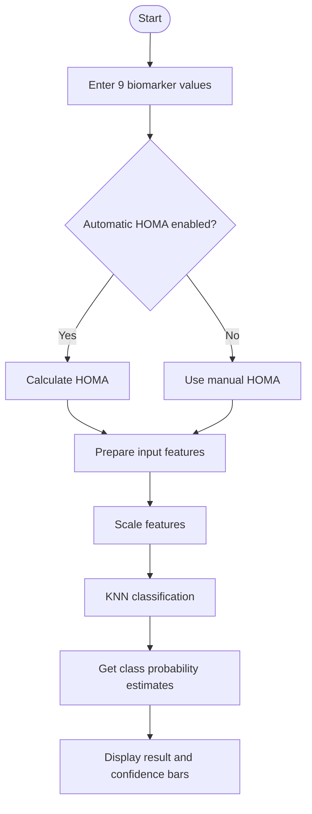

🩺 GlucoInsulin-Predict
Interactive Biomarker Screening with Machine Learning
An interactive Streamlit application that uses a trained K-Nearest Neighbors (KNN) model to classify biomarker profiles into a Control group or Patient group.

  
  

  
  
  
  

🌟 Overview
GlucoInsulin-Predict is a machine-learning-based biomarker screening project with an interactive web interface. Users enter body measurements and biomarker values, run a classification, and view the predicted group alongside the model's class-confidence estimates.
⚕️ Disclaimer: This project is for educational and experimental purposes only. It is not a medical diagnostic tool and must not be used to make treatment decisions. Consult a qualified healthcare professional for medical advice.

✨ Key Features
Feature	Description
🧍 Body measurements	Enter age and BMI
🩸 Glucose and insulin	Enter glucose and insulin measurements
🧮 Automatic HOMA	Calculate HOMA from glucose and insulin, or enter it manually
🧬 Biomarker inputs	Leptin, adiponectin, resistin, and MCP-1
📊 Visual prediction	View the predicted group and model confidence estimates
🧾 Input summary	Review the values used for classification
🔄 Reset controls	Restore default input values

🧪 Input Features
The application uses nine features:
Feature	Unit shown in app
Age	Years
BMI	kg/m²
Glucose	mg/dL
Insulin	µU/mL
HOMA	—
Leptin	ng/mL
Adiponectin	µg/mL
Resistin	ng/mL
MCP-1	pg/mL

🔍 How It Works

1. Input: Collect the nine biomarker values.
2. Preprocessing: Arrange the values in the feature order expected by the model.
3. Scaling: Transform the inputs using the saved scaler.
4. Prediction: Use the trained KNN model to classify the profile.
5. Visualization: Display the predicted group and class-confidence estimates.
HOMA Formula
When automatic calculation is enabled, the application uses:
\[
\text{HOMA} = \frac{\text{Glucose} \times \text{Insulin}}{405}
\]
This calculation follows the implementation in the application and is not a substitute for clinical interpretation.
🖥️ Screenshots
To show screenshots here, first upload actual screenshots from your running app into a screenshots folder in this repository. Then uncomment and update the image paths below.
<!--

  
  

-->

🛠️ Tech Stack
- Python — application logic
- Streamlit — interactive web interface
- Pandas — tabular data preparation
- NumPy — numerical operations
- Scikit-learn — scaling and KNN inference
- Pickle — loading the saved model and scaler
📁 Repository Structure
GlucoInsulin-Predict/
├── app.py
├── model.pkl
├── scaler.pkl
├── requirements.txt
└── README.md
⚙️ Run Locally
1. Clone the repository
git clone https://github.com/devyaniraghatate/GlucoInsulin-Predict.git
cd GlucoInsulin-Predict
2. Install dependencies
python -m pip install --upgrade pip
pip install -r requirements.txt
pip install streamlit
3. Start the app
streamlit run app.py
Open the local URL shown in your terminal.
Note: app.py imports Streamlit, but requirements.txt does not currently list it. Add streamlit to requirements.txt so users can install all dependencies with one command.
Ensure model.pkl and scaler.pkl are present in the project root. Only load pickle files from sources you trust.
🔐 Limitations & Responsible Use
- Predictions depend on the model, training data, feature definitions, and preprocessing.
- Confidence estimates are model outputs, not guarantees of correctness or clinically validated probabilities.
- No accuracy figure is claimed here because a verified evaluation result has not been documented.
- Do not use this app to diagnose a condition or decide on treatment.
🚀 Future Improvements
- Document the dataset source and model-training process.
- Add verified accuracy, precision, recall, F1-score, and confusion matrix results.
- Pin tested package versions in requirements.txt.
- Add screenshots and a short demo GIF.
- Add tests for input validation and prediction handling.
👩‍💻 Author
Devyani Raghatate
- GitHub Profile
- Project Repository
- Launch Live App

  <i>Built with Python, Streamlit, and Machine Learning.</i>

